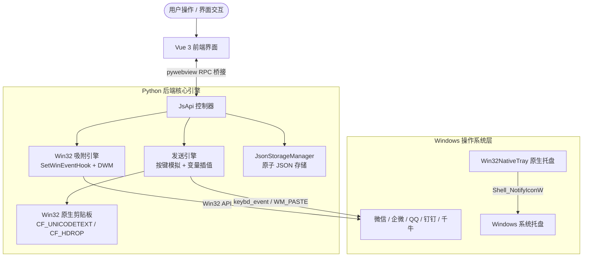

# 💬 微信多开聊天助手 (ChatHelper)

[](https://microsoft.com/windows)
[](https://www.python.org/)
[](https://vuejs.org/)
[](https://pywebview.flowrl.com/)
[](LICENSE)

基于 **Python 3 + pywebview (Microsoft Edge WebView2) + Vue 3 (Vite)** 打造的现代化客服与多开聊天快捷话术与智能吸附助手。专为电商客服、社群运营、销售团队及多会话重度用户设计，提供 0 延迟原生贴边跟随、多模态附件发送、智能变量插值与优雅的 Fluent 毛玻璃界面。

---

## 🌟 核心特性

### 1. 🧲 Win32 原生事件驱动贴边吸附 (Event-Driven Docking)
- **底层 OS 原生事件驱动**：采用 Windows `SetWinEventHook` 监听 `EVENT_OBJECT_LOCATIONCHANGE`、`EVENT_SYSTEM_FOREGROUND` 与 `EVENT_OBJECT_NAMECHANGE` 等系统级事件，**拖动窗口 0 延迟跟手，杜绝传统轮询带来的延迟与画面撕裂**；
- **DWM 真实物理边框校准**：通过 `DwmGetWindowAttribute` 获取 `DWMWA_EXTENDED_FRAME_BOUNDS`，彻底消除 Windows 10/11 系统 7px 的隐形阴影透明缝隙；
- **智能宿主感知与静默驻留**：
  - 启动时自动扫描已运行的 IM 会话窗口并吸附贴靠；
  - 若未检测到目标软件，自动在后台静默托盘驻留，不弹出孤立窗口打扰用户；
  - 宿主窗口最小化或关闭时即刻智能隐藏；
- **会话标题动态同步**：自动感知当前对话的好友/群聊名称并实时同步至助手顶栏；
- **微型悬浮球一键折叠**：支持一键将面板收起为右上角微型悬浮小图标（`CollapsedBubble`），释放屏幕空间。

### 2. 📱 广泛支持主流聊天客户端
支持在「系统设置」中独立勾选启用或禁用吸附目标：
- 🟢 **微信 (WeChat / Weixin)**：全面兼容 3.x / 4.x 版本；
- 🔵 **企业微信 (WeWork)**；
- 🐧 **腾讯 QQ / TIM**；
- 🔷 **钉钉 (DingTalk)**；
- 🟠 **千牛工作台 (AliWorkbench)**。

### 3. 🚀 多模态剪贴板与智能发送引擎
- **原生文件批量注入（`CF_HDROP`）**：原生 Win32 剪贴板技术，支持多文件、高清图片、视频等批量直接注入聊天输入框；
- **智能动态变量插值**：话术内容支持嵌入动态时间与问候语占位符，发送时实时计算并替换；
- **5 种专业发送模式**：
  1. **标准发送**：文本 + 顺序多附件快速粘贴并自动回车发送；
  2. **逐字慢发（打字机）**：按字符模拟人工敲击节奏逐字发送，可配置单字间隔；
  3. **连发 3 次**：重要通告、紧急通知快速连发 3 轮；
  4. **倒序发送**：将文本字符逆序翻转发送，满足特殊趣味互动场景；
  5. **仅粘贴不回车**：将话术与附件精准填入输入框，保留人工二次确认与微调空间。

### 4. 🎨 Vue 3 + Fluent Glassmorphism 现代化界面
- **双主题随心切换**：支持深色暗黑模式（Dark Mode）与明亮毛玻璃（Light Glass）无缝切换；
- **高密度紧凑布局**：左侧话术卡片流 + 右侧竖向分类快捷导航条，带未读/总数徽标；
- **即时模糊全文搜索**：毫秒级响应，支持标题、正文、标签的综合多维筛选；
- **防遮挡悬浮动作菜单**：卡片右侧快捷操作，自动计算视口边界避免溢出；
- **分类与话术全功能管理**：支持右键分类管理（新增、重命名、级联删除）、拖拽与多附件选取管理、删除二次确认防护。

### 5. 💾 原子化 JSON 存储与免驱备份
- **零外部数据库依赖**：采用本地 `%APPDATA%\ChatHelper\data.json` 纯 JSON 格式存储，彻底摆脱 SQLite 驱动及 DLL 依赖，体积更轻、性能更稳；
- **原子写入与线程安全**：通过 RLock 与临时文件替换机制（Atomic Write），杜绝意外掉电或崩溃导致的数据损坏；
- **一键导出备份与全量还原**：内置跨设备数据迁移功能，支持以 JSON 格式一键备份或导入话术库。

### 6. 📦 纯 Win32 原生托盘与单文件绿色打包
- **纯 Win32 API 托盘实现**：移除 PIL / Pillow / pystray 等重量级依赖，体积直降数十兆；
- **单例互斥锁**：`ChatHelper_Python_Mutex` 保证单实例运行，避免多进程冲突；
- **极简独立绿色打包**：提供自动化构建脚本 `build_app.py`，一键生成免安装单文件 `ChatHelper.exe`。

---

## 🏗️ 架构与模块设计



---

## 📁 目录结构

```
ChatHelper/
├── src/                          # Python 核心后端源码
│   ├── api.py                    # pywebview RPC 桥接层 (前后端接口)
│   ├── docking_engine.py         # Win32 原生事件驱动贴边吸附与窗口跟随引擎
│   ├── send_engine.py            # 智能变量插值与按键模拟发送引擎
│   ├── storage.py                # 轻量原子化 JSON 数据存储与备份管理器
│   ├── database.py               # 数据库管理兼容层
│   ├── tray_manager.py           # 纯 Win32 原生托盘菜单管理器
│   ├── win32_clipboard.py        # Windows 原生剪贴板注入 (文本 / CF_HDROP 文件)
│   └── main.py                   # 应用程序主入口
├── frontend/                     # Vue 3 + Vite 现代化前端
│   ├── src/
│   │   ├── assets/               # 样式资源 (main.css Fluent 变量系统)
│   │   ├── components/           # UI 业务组件
│   │   │   ├── CategoryModal.vue     # 分类新增/编辑弹窗
│   │   │   ├── CategoryNav.vue       # 右侧分类竖向导航条
│   │   │   ├── CollapsedBubble.vue   # 贴边折叠微型悬浮球
│   │   │   ├── ConfirmModal.vue      # 二次确认删除弹窗
│   │   │   ├── FloatingMenu.vue      # 智能防遮挡快捷操作菜单
│   │   │   ├── HeaderBar.vue         # 顶栏与目标会话状态
│   │   │   ├── ReplyCard.vue         # 话术卡片项
│   │   │   ├── ReplyCardList.vue     # 话术卡片滚动流
│   │   │   ├── ReplyEditModal.vue    # 话术编辑与附件选择弹窗
│   │   │   ├── SearchBar.vue         # 快捷搜索与新建栏
│   │   │   ├── SettingsModal.vue     # 系统设置与备份恢复弹窗
│   │   │   └── Toast.vue             # 全局消息反馈组件
│   │   ├── App.vue               # 前端主视图容器
│   │   └── main.js               # 前端入口
│   ├── package.json              # 前端依赖配置
│   └── vite.config.js            # Vite 构建配置
├── tests/                        # pytest 自动化测试套件
│   ├── test_api.py               # RPC API 接口测试
│   ├── test_database.py          # 存储持久化与备份恢复测试
│   ├── test_docking_engine.py    # 贴边坐标计算与目标识别测试
│   └── test_send_engine.py       # 变量插值与发送逻辑测试
├── docs/                         # 架构文档与开发规划
├── build_app.py                  # 自动化前端编译与 PyInstaller 单文件打包脚本
├── requirements.txt              # Python 依赖清单
├── app.ico                       # 高清应用程序图标
└── README.md                     # 项目说明文档
```

---

## 🧩 快捷变量与发送模式

### 1. 动态智能变量表
在编辑话术内容时，可自由插入以下占位符，发送时将自动替换为实时值：

| 占位符 | 替换示例 | 说明 |
| :--- | :--- | :--- |
| `{日期}` | `2026-08-26` | 当前完整年月日（YYYY-MM-DD） |
| `{时间}` | `19:30:00` | 当前时刻（HH:MM:SS） |
| `{星期}` | `星期三` | 当前星期几（中文） |
| `{问候语}` | `早上好` / `下午好` / `晚上好` | 根据当前时间自动计算适配的礼貌问候 |
| `{年}` | `2026` | 4 位年份数字 |
| `{月}` | `08` | 2 位月份数字 |
| `{日}` | `26` | 2 位日期数字 |

### 2. 5 种发送模式对比

| 模式名称 | 触发方式 | 发送逻辑 | 适用场景 |
| :--- | :--- | :--- | :--- |
| **标准发送** | 单击卡片发送按钮 / 快捷键 | 文本 + 附件极速粘贴并自动回车 | 最常用的高频快速应答 |
| **逐字慢发** | 悬浮菜单 ➔ 逐字慢发 | 占位符替换后按字模拟敲击打字 | 模拟真人手工输入，减少机械感 |
| **连发 3 次** | 悬浮菜单 ➔ 连发 3 次 | 相同内容间隔自动重复发送 3 轮 | 重要通知催促、广播或确认提示 |
| **倒序发送** | 悬浮菜单 ➔ 倒序发送 | 字符逆向翻转输出 | 趣味沟通与防折叠测试 |
| **仅粘贴不回车** | 悬浮菜单 ➔ 仅粘贴 | 仅将文字与附件注入到聊天输入框 | 发送前需要临时微调或补充说明 |

---

## 🚀 快速开始与开发指南

### 环境准备
- **操作系统**：Windows 10 / Windows 11
- **Python**：Python 3.10+
- **Node.js**：Node.js 18+ (包含 npm)
- **系统运行时**：Microsoft Edge WebView2 (Windows 10 1809+ 及 Windows 11 已默认内置)

### 1. 克隆代码并安装依赖

```bash
# 克隆仓库
git clone https://github.com/your-username/ChatHelper.git
cd ChatHelper

# 安装 Python 后端依赖
python -m pip install -r requirements.txt

# 安装前端依赖
cd frontend
npm install
cd ..
```

### 2. 运行自动化测试套件

本项目内置了完整的单元测试与集成测试，覆盖 RPC API、存储引擎、吸附算法和发送逻辑：

```bash
python -m pytest tests/ -v
```

### 3. 本地联合调试开发

开启前后端热重载开发模式：

```bash
# 步骤 1：启动 Vite 前端开发服务器 (终端 1)
cd frontend
npm run dev

# 步骤 2：启动 Python 桌面宿主窗口 (终端 2)
python src/main.py
```
> **提示**：当检测到本地 Vite 服务 (`http://localhost:5173`) 时，`pywebview` 会自动加载开发服务器页面，支持前端代码热更新（HMR）。

### 4. 一键单文件绿色打包

项目提供了全自动化的构建打包脚本 `build_app.py`：

```bash
python build_app.py
```

该脚本将自动执行以下步骤：
1. 自动安全终止运行中的旧实例；
2. 构建 Vue 3 前端生产静态资源到 `frontend/dist/`；
3. 清理旧的编译缓存与临时目录；
4. 深度剪裁无用依赖库（精简体积），使用 PyInstaller 生成具备管理员权限声明、内置图标的免安装单文件 `dist/ChatHelper.exe`。

---

## ⚙️ 数据存储与备份恢复

### 1. 数据存储位置
所有分类、话术内容及偏好设置均保存在当前 Windows 用户的 Application Data 目录下：
```
%APPDATA%\ChatHelper\data.json
# 实际物理路径通常为：C:\Users\<用户名>\AppData\Roaming\ChatHelper\data.json
```

### 2. 数据结构格式
```json
{
  "categories": [
    { "id": 1, "name": "常用问候", "sort_order": 1 },
    { "id": 2, "name": "售后服务", "sort_order": 2 }
  ],
  "quick_replies": [
    {
      "id": 1,
      "category_id": 1,
      "title": "快捷问候",
      "content": "您好！祝您{问候语}，请问有什么可以帮您？",
      "attachments": [],
      "tags": ["高频", "问候"],
      "sort_order": 1,
      "use_count": 12
    }
  ],
  "app_settings": {
    "dark_mode": "0",
    "supported_ims": "[\"wechat\", \"wxwork\", \"qq\", \"tim\", \"dingtalk\", \"aliworkbench\"]"
  }
}
```

### 3. 数据备份与恢复
- **导出备份**：点击面板右上角「设置」图标 ➔ 「数据管理与备份」 ➔ 点击「备份导出」，选择保存位置即可生成带时间戳的 `.json` 备份文件；
- **全量还原**：点击「还原覆盖」选择之前备份的 `.json` 文件，系统将自动校验数据完整性并执行全量热更新。

---

## ❓ 常见问题排查 (FAQ)

### Q1: 打开微信或 QQ 后，助手没有自动吸附在其右侧？
1. 请确认目标聊天软件在「系统设置 ➔ 支持的聊天软件」中已被勾选启用；
2. 请确认当前聊天窗口是否处于激活（获得前台焦点）状态；若目标软件处于最小化或托盘后台状态，助手会自动隐藏；
3. 如果目标聊天软件以**管理员权限 (Administrator)** 运行，助手也需要以管理员权限运行（打包生成的 `ChatHelper.exe` 已默认请求管理员权限）。

### Q2: 发送图片或文件附件时，提示无法粘贴？
1. 请检查话术中引用的本地附件文件是否已被移动、重命名或删除；
2. 发送大尺寸视频或文件时，聊天软件需要一定时间生成预览缩略图，可在设置中适当增加发送延时参数。

### Q3: 杀毒软件（如 Windows Defender / 360）报毒或拦截？
由于程序使用了 Win32 底层 API（`SetWinEventHook` 监听窗口事件、`keybd_event` 模拟键盘发送、`CreateMutexW` 进程互斥），部分启发式杀毒引擎可能会误报。请将程序加入白名单或信任区，本项目完全开源透明，无任何恶意行为。

---

## 📄 开源协议与免责声明

- 本项目基于 [MIT License](LICENSE) 开源协议分发；
- 本工具仅作为提高日常打字与客户沟通效率的辅助工具，不包含任何破解、注入反编译或篡改第三方软件通信协议的功能；
- 请在遵守相关聊天软件使用规范的前提下合理使用。
